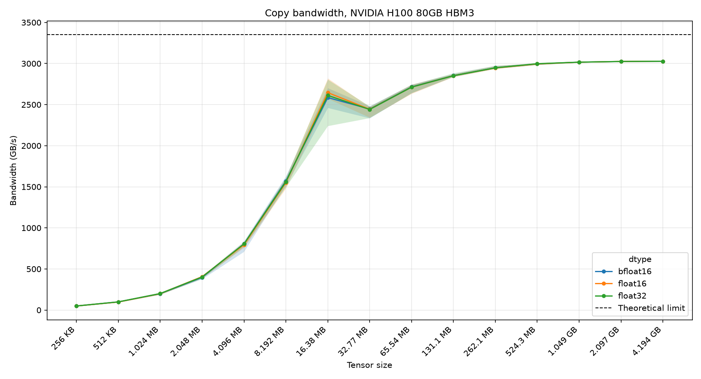
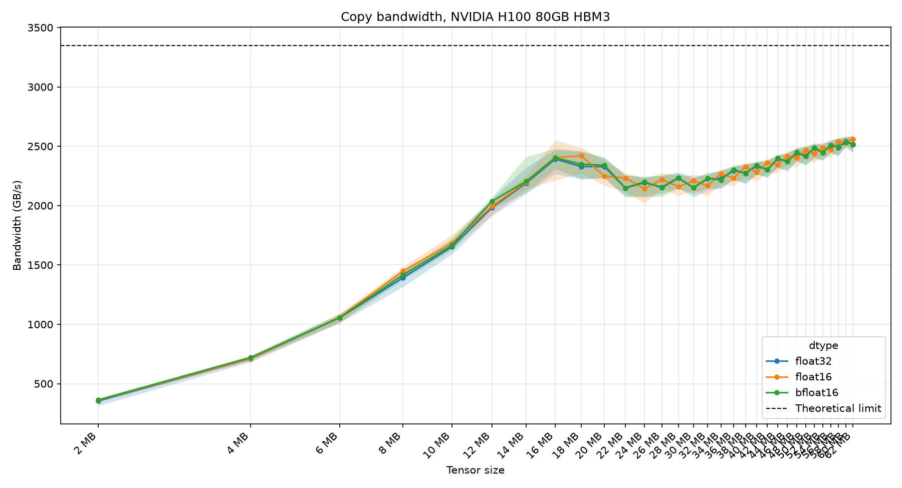

# H100 memory bandwidth

**Question:** how much of the H100 SXM's 3.35 TB/s HBM3 bandwidth can a plain device-to-device copy reach, and how does that change with tensor size?

**Answer:** about **3.03 TB/s (~90% of spec)** for copies of 1 GB and up. Below about 8 MB the copy is limited by a fixed ~10 µs per-call cost, not by bandwidth.



## Method

- `dest.copy_(src)` on contiguous tensors of the same dtype, which PyTorch sends to `cudaMemcpyAsync` (device to device).
- Bandwidth = `2 × size / time`, because a copy reads every byte once and writes it once.
- Timed with CUDA events: 50 warmup iterations, then 100 timed iterations, each recorded on its own (`benchmarks/timing.py`). Lines show the median and shaded bands show p10 to p90.
- Sizes go from 256 KB to 4 GB, doubling each step, in float32, float16 and bfloat16. The dtype makes no difference here: the copy only moves bytes.
- Hardware and software: see [`results/device.txt`](results/device.txt) and the header of each results file.

## Results

| Tensor size | Median bandwidth (bf16) |
| --- | --- |
| 1 MB | 0.20 TB/s |
| 16 MB | 2.59 TB/s |
| 33 MB | 2.45 TB/s |
| 262 MB | 2.95 TB/s |
| 4.2 GB | 3.03 TB/s |

Data: [`results/copy_results.txt`](results/copy_results.txt).

### The bump at 16 MB

The coarse sweep peaks near 16 MB with a wide p10 to p90 band, then drops at 32 MB before climbing back. [`peak_analysis.py`](peak_analysis.py) repeats the sweep from 2 MB to 62 MB in 2 MB steps ([`results/copy_small_data_sweep_results.txt`](results/copy_small_data_sweep_results.txt)):



Median bandwidth reaches about 2.4 TB/s at 16 MB, falls to about 2.15 TB/s between 22 and 30 MB, then rises steadily.

**Cause: the source stays in L2 between iterations.** Nsight Compute counters for a copy-shaped kernel, profiled with ncu's cache flushing turned off so L2 contents carry over between launches as they do in the benchmark ([`results/l2_profile.txt`](results/l2_profile.txt), mean of 5 launches):

| Size | DRAM read / size | DRAM write / size | L2 read hit | Kernel time | Effective bandwidth |
| --- | --- | --- | --- | --- | --- |
| 16 MB | 0.15 | 0.03 | 56% | 9.1 µs | 3.51 TB/s |
| 18 MB | 0.39 | 0.08 | 42% | 10.4 µs | 3.45 TB/s |
| 20 MB | 0.64 | 0.12 | 21% | 11.9 µs | 3.36 TB/s |
| 22 MB | 0.86 | 0.16 | 9% | 13.3 µs | 3.31 TB/s |
| 24 MB | 0.96 | 0.22 | 1.5% | 14.8 µs | 3.24 TB/s |
| 26 MB | 0.99 | 0.26 | 0.2% | 16.0 µs | 3.25 TB/s |
| 256 MB | 1.00 | 0.92 | 0% | 167 µs | 3.07 TB/s |

- At 16 MB, 85% of the source is served from L2, so the kernel runs faster than HBM alone allows (3.51 TB/s against the 3.35 TB/s spec).
- Between 16 and 24 MB the source drops out of L2 gradually rather than all at once. By 24 MB (a 48 MB working set, close to the 50 MB L2) nearly every read goes to DRAM.
- Writes stay mostly in L2 for longer: at 26 MB only about a quarter of the written bytes reach DRAM within the kernel. At 256 MB the kernel streams fully from and to HBM.

Caveat: the profiled kernel is `mul(src, 1)`, not `copy_` (ncu cannot profile the `cudaMemcpyAsync` that `copy_` uses). The kernel times above are shorter than what `copy_` measures with CUDA events, for example 9.1 µs against 13.4 µs at 16 MB, because `copy_` carries the fixed per-call cost visible at small sizes. The counters explain why the bump exists, but the depth of the dip in the plot also reflects that overhead.

## Reproduce

Requires one H100 GPU. From the repo root:

```bash
uv sync
uv run python -m benchmarks.h100_bandwidth.bench_copy        # writes results/copy_results.txt
uv run python -m benchmarks.h100_bandwidth.plot_bandwidth    # writes plots/bandwidth.png (CPU only)
uv run python -m benchmarks.h100_bandwidth.peak_analysis     # 2-62 MB sweep and plot; --plot-only redraws without a GPU
```

To test the L2 hypothesis, [`profile_l2.sh`](profile_l2.sh) runs Nsight Compute on a copy-shaped kernel at 16 to 26 MB in 2 MB steps, plus 256 MB. It records DRAM bytes and L2 read/write hit rates, with ncu's cache flushing and clock locking turned off so the profile matches the benchmark's steady state. See the docstring of [`profile_minimal.py`](profile_minimal.py) for why the kernel uses `mul` rather than `copy_`.

```bash
bash benchmarks/h100_bandwidth/profile_l2.sh                    # raw ncu CSVs to .logs/
uv run python -m benchmarks.h100_bandwidth.summarise_l2_profile  # writes results/l2_profile.txt (CPU only)
```
